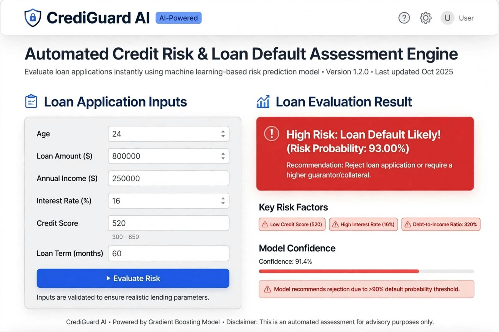
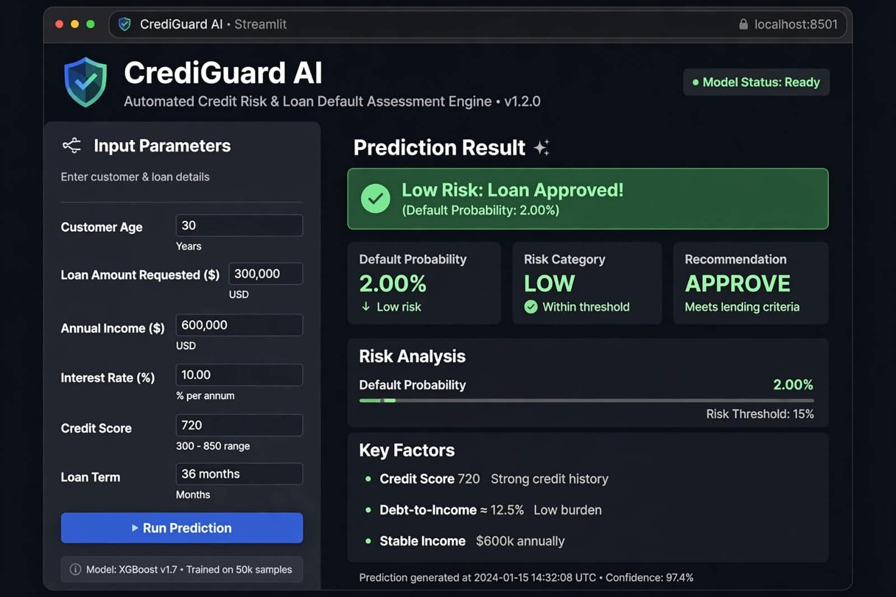

# 🛡️ CrediGuard AI - Automated Credit Risk & Loan Default Assessment Engine

## 🚀 Live Demo: [https://crediguard-ai18107.streamlit.app](https://crediguard-ai18107.streamlit.app)

An end-to-end AI-powered system for automating credit risk analysis and predicting loan default probability in real-time.

### 🚀 Key Features
- **SQL Relational Database:** Structured schema with `customers` and `loan_records` for audit logging
- **Data Pipeline:** Automated data cleaning and feature engineering with Pandas
- **ML Model:** Handles imbalanced data using SMOTE and predicts default probability with XGBoost/Random Forest
- **Interactive UI:** Real-time risk assessment with Streamlit

### 🛠️ Tech Stack
Python, Streamlit, SQLite, Pandas, NumPy, Scikit-Learn, Imbalanced-Learn (SMOTE)

### 📸 Screenshots



### ⚙️ How to Run
```bash
pip install -r requirements.txt
streamlit run app.py